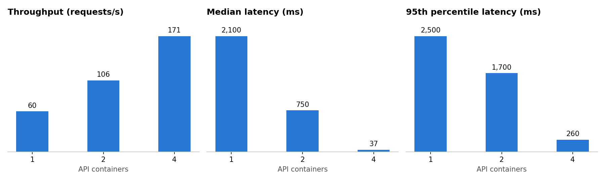

# Bean Leaf Disease Detection: an End-to-End ML Pipeline

**Video demo:** [YouTube link](ADD_YOUTUBE_LINK_HERE)
**App URL:** http://localhost:8080 (runs in Docker, see [Setup](#setup))
**API docs:** http://localhost:8080/docs

## Project description

Beans are a staple crop across East Africa, and two leaf diseases, **angular leaf spot** and **bean rust**, can cut yields badly if farmers don't catch them early. Most smallholder farmers can't get an agronomist to look at every field. This project takes a photo of a bean leaf and classifies it as angular leaf spot, bean rust or healthy.

It covers the full ML cycle:

- **Data acquisition:** the iBean dataset (Makerere AI Lab, MIT licence) from [Hugging Face](https://huggingface.co/datasets/AI-Lab-Makerere/beans). It has 1,034 train, 133 validation and 128 test images, roughly balanced across the three classes.
- **Preprocessing:** images are decoded, converted to RGB, resized to 224 x 224 and scaled inside the model. Training uses random flips, rotation, zoom and contrast as augmentation.
- **Model:** MobileNetV2 pretrained on ImageNet, trained in two stages. First only the new classification head is trained, then the top 30 layers are fine-tuned at a low learning rate.
- **API:** FastAPI service for prediction, bulk upload, retraining and monitoring.
- **UI:** a web dashboard showing model uptime, evaluation results, data insights, single-image prediction, bulk upload and a retrain button.
- **Retraining:** uploaded images are saved to a SQLite database and preprocessed. The model currently in service is then fine-tuned as the pretrained starting point.
- **Deployment:** Docker containers behind an nginx load balancer. Locust floods the API with requests across 1, 2 and 4 containers.

## Model evaluation

Results on the held-out **test set of 128 images**, which was never used for training or model selection:

| Metric | Score |
|---|---|
| Accuracy | 0.906 |
| Precision (macro) | 0.911 |
| Recall (macro) | 0.907 |
| F1 score (macro) | 0.906 |
| ROC-AUC (one vs rest) | 0.986 |
| Cohen's kappa | 0.859 |
| Loss | 0.235 |

Confusion matrix (rows are the true class, columns are the predicted class):

| | Angular leaf spot | Bean rust | Healthy |
|---|---|---|---|
| **Angular leaf spot** | 41 | 2 | 0 |
| **Bean rust** | 7 | 35 | 1 |
| **Healthy** | 1 | 1 | 40 |

Healthy leaves are recognised best (F1 0.96). The weakest class is bean rust, with recall 0.81: 7 of 43 rust leaves were predicted as angular leaf spot. The two diseases look alike at an early stage. Still, 85 of the 86 diseased test leaves were flagged as diseased, which matters most for a farmer.

**Optimisation techniques used:** transfer learning, data augmentation, dropout (0.3), L2 regularisation (1e-4), the Adam optimiser, early stopping, learning-rate reduction on plateau, and checkpointing of the best weights. A frozen-backbone baseline scored 0.891 accuracy, 0.302 loss and 0.977 ROC-AUC. Fine-tuning lowered the test loss to 0.235 and raised ROC-AUC to 0.986.

The full preprocessing, training, evaluation and prediction steps are in [notebook/bean_leaf_disease.ipynb](notebook/bean_leaf_disease.ipynb).

## Data insights

These three features were measured on the leaf area of 1,031 training images. All three are shown as charts in the dashboard.

1. **Leaf yellowing:** a typical angular leaf spot leaf is 7.1% yellow, about 4.6 times a healthy leaf (1.5%). Bean rust stays close to healthy at 2.2%, so yellowing points to angular leaf spot but can't detect rust on its own.
2. **Lesion coverage:** brown damage covers 3.7% of a typical angular leaf spot leaf and 2.5% of a bean rust leaf, against 1.1% for healthy leaves. The two diseases overlap heavily here, which helps explain why they are the hardest pair for the model to separate.
3. **Surface specks:** healthy leaves have about 1.8 small specks per 1,000 leaf pixels, compared with 4.3 for bean rust and 6.5 for angular leaf spot. Fine surface texture is the clearest of the three signals that a leaf is diseased, and it's the kind of detail a CNN can learn.

## Setup

### Option 1: Docker (recommended)

Requirements: [Docker Desktop](https://www.docker.com/products/docker-desktop/) with at least 4 GB of memory available.

```bash
git clone https://github.com/Aderline490/bean-leaf-mlops.git
cd bean-leaf-mlops
docker compose up -d --build --wait --scale api=4
```

Open http://localhost:8080 for the dashboard. The first build downloads TensorFlow and takes several minutes.

- Change the number of API containers: `docker compose up -d --wait --scale api=2`
- Stop everything: `docker compose down`. Add `-v` to also delete uploaded images and retrained versions.
- To protect uploads and retraining on a shared machine, set `ADMIN_TOKEN=your-secret` before `docker compose up`. Then enter it in the API key box that appears in the dashboard.

### Option 2: Run locally with Python

Requirements: Python 3.9.

```bash
python3.9 -m venv .venv
source .venv/bin/activate        # Windows: .venv\Scripts\activate
pip install -r requirements.txt
uvicorn src.api:app --port 8000
```

Open http://localhost:8000.

Other commands, run from the project root:

| Task | Command |
|---|---|
| Predict one image from the terminal | `python -m src.prediction demo/predict/demo_bean_rust.jpg` |
| Train the first model version from scratch | `python -m src.train` |
| Run the notebook | `pip install -r requirements-dev.txt`, then `jupyter notebook notebook/bean_leaf_disease.ipynb` |

## Using the app

**Predict one image:** in the dashboard, choose a leaf photo and press Predict. The app shows the predicted class, the confidence and the probability of each class. Clear test images are in [demo/predict/](demo/predict/), one per class. The current model predicts all three correctly.

**Retrain:**

1. Under **Upload data and retrain**, pick the true class, select several leaf images and press **Upload images**. The images are checked, resized and saved to the database. Duplicates, unreadable files and images from the validation or test sets are rejected, so they can't leak into evaluation.
2. Press **Retrain model**. You need at least 6 uploaded images. The job runs in the background, and the dashboard shows its progress epoch by epoch.
3. Retraining starts from the model currently in service and fine-tunes it on the original training data plus the new uploads. Class weights keep the classes balanced.
4. The new version is compared with the current one on the validation set. It only goes into service if its macro F1 is at least as good. The switch happens without restarting the API, and the dashboard then shows the new version number.

Retraining can also start automatically: set `AUTO_RETRAIN=true` to start it after 30 new uploads. Change `RETRAIN_AUTO_THRESHOLD` to use a different number.

### API endpoints

| Method | Path | Purpose |
|---|---|---|
| GET | `/health` | Uptime, model version, request and error counts |
| POST | `/predict` | Classify one uploaded image |
| POST | `/upload` | Bulk upload labelled images for retraining |
| GET | `/uploads/summary` | Uploaded images waiting for retraining |
| POST | `/retrain` | Start a retraining job |
| GET | `/retrain/{job_id}` | Status of a retraining job |
| GET | `/retrain/jobs` | Recent retraining jobs |
| GET | `/model/metrics` | Evaluation results of the model in service |
| GET | `/insights` | Feature data behind the dashboard charts |
| GET | `/classes` | List of classes |

Interactive documentation is at `/docs`.

## Flood request simulation (Locust)

Locust sent image predictions to the nginx gateway while the number of API containers changed. Each container was limited to 1 CPU and 2 GB of memory. Each simulated user waited 0.5 to 1.5 seconds between requests. Every response was checked for the correct label, not just a 200 status. The ramp-up period is excluded from the numbers.

**200 users for 75 seconds, `POST /predict`:**

| API containers | Requests | Failures | Requests/s | Median (ms) | 95th percentile (ms) | 99th percentile (ms) |
|---|---|---|---|---|---|---|
| 1 | 3,944 | 0 | 59.6 | 2,100 | 2,500 | 2,800 |
| 2 | 6,982 | 0 | 105.5 | 750 | 1,700 | 2,000 |
| 4 | 11,134 | 0 | 170.9 | 37 | 260 | 750 |



With one container, the CPU sat at 100% and requests queued for about two seconds. Four containers handled 2.9 times as many requests per second, and the median response time dropped from 2.1 seconds to 37 ms. No request failed in any run.

**40 users for 60 seconds:** one container already kept up, with a median of 26 ms and 0 failures. The 1, 2 and 4 container runs all handled about 35 requests per second. Extra containers only help once a single container is overloaded.

These tests ran on one laptop, with Locust on the same machine as the containers, and each setup was run once. Full HTML reports are in [results/locust/](results/locust/).

To repeat the test, install the dev requirements and pass the number of users and the duration:

```bash
pip install -r requirements-dev.txt
scripts/run_load_tests.sh 200 75s
```

## Project structure

```
bean-leaf-mlops/
├── README.md
├── notebook/
│   └── bean_leaf_disease.ipynb   # preprocessing, training, evaluation, prediction
├── src/
│   ├── preprocessing.py          # image loading, validation and resizing
│   ├── model.py                  # model building, training and evaluation
│   ├── prediction.py             # loads the model in service and predicts
│   ├── train.py                  # trains the first model version
│   ├── retrain.py                # retraining with validation-based promotion
│   ├── insights.py               # feature extraction for the data insights
│   ├── database.py               # SQLite storage for uploads and jobs
│   ├── config.py                 # settings
│   └── api.py                    # FastAPI application
├── ui/                           # web dashboard (HTML, CSS, JavaScript)
├── data/
│   ├── train/
│   ├── validation/
│   └── test/
├── models/
│   ├── bean_leaf_model.keras     # trained model (Keras format)
│   ├── metrics.json
│   ├── history.json
│   └── insights.json
├── demo/predict/                 # one clear test image per class
├── load_tests/locustfile.py
├── results/locust/               # load test results
├── scripts/                      # load test and helper scripts
├── deploy/nginx.conf             # load balancer configuration
├── Dockerfile
└── docker-compose.yml
```

The model is saved in the `.keras` format, which is TensorFlow's current native format.

## Dataset credit

iBean dataset by the AI Lab, Makerere University, released under the MIT licence.
